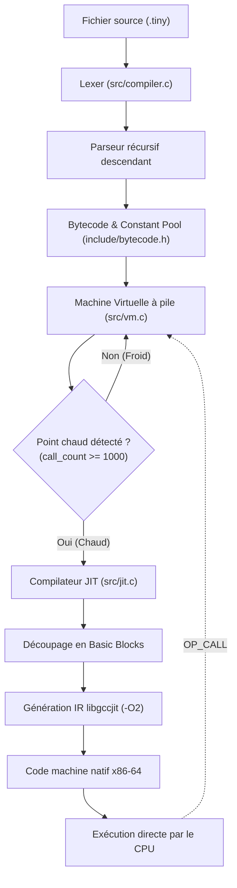

# TinyJIT

[](https://en.wikipedia.org/wiki/C11_(C_standard_revision))
[](https://gcc.gnu.org/onlinedocs/jit/)
[]()
[]()
[]()

**TinyJIT** est un environnement d'exécution complet et moderne pour un langage dynamique impératif. Il combine une chaîne de compilation front-end en C11, un interpréteur de bytecode à pile réentrant, un compilateur **Just-In-Time (JIT)** natif propulsé par **`libgccjit`**, et un **Studio Graphique interactif** de visualisation et de benchmarking.

Lorsqu'une fonction est fréquemment appelée (« point chaud » / *hotspot*), le moteur JIT traduit automatiquement son bytecode en code machine natif **x86-64** optimisé (`-O2`), offrant des accélérations supérieures à **200x** par rapport à l'interpréteur classique.

---

## ⚡ Interface Graphique : TinyJIT Studio

TinyJIT intègre **TinyJIT Studio**, un environnement interactif moderne (thème sombre obsidian, réactif, sans dépendance lourde) pour éditer, exécuter, déboguer et visualiser l'exécution du compilateur JIT en direct dans le navigateur :

- **Éditeur Source réactif** : Coloration syntaxique pour le langage `.tiny`, numérotation des lignes, raccourci d'exécution rapide `Ctrl+Enter`.
- **Désassembleur de Bytecode interactif** : Tableau exhaustif des instructions émises, des tables de fonctions et des pools de constantes avec catégorisation par couleurs (sauts, arithmétique, pile, retours).
- **Inspecteur Assembleur x86-64 (style *Godbolt / Compiler Explorer*)** : Visualisation du code machine natif produit à la volée par `libgccjit` avec surlignage des registres CPU (`%rax`, `%rbx`, `%rcx`, etc.) et des étiquettes.
- **Graphe de Flot de Contrôle (CFG / *Basic Blocks*)** : Découpage visuel des blocs de base et visualisation des transitions conditionnelles / inconditionnelles.
- **Tableau de bord de Benchmark (Chart.js)** : Comparaison graphique en direct entre l'interpréteur seul, le mode hybride JIT et le code C natif compilé.
- **Console de télémétrie en temps réel** : Badges d'état du JIT (détection du point chaud, fonctions compilées), temps d'exécution précis en microsecondes et flux stdout/stderr formaté.

### Lancer TinyJIT Studio en 1 clic :
```powershell
# Lanceur PowerShell tout-en-un (compile le moteur C si besoin et ouvre le navigateur) :
.\gui.ps1

# Ou directement via Python :
python studio.py
```
L'interface s'ouvre automatiquement sur `http://127.0.0.1:8765`.

---

## 🏛 Architecture globale



### Le pipeline d'exécution en 4 niveaux :
1. **Front-End (`src/compiler.c`)** : Analyse lexicale et syntaxique d'une seule passe qui génère directement le bytecode, résout les variables locales et applique le *backpatching* pour les sauts conditionnels.
2. **Interpréteur réentrant (`src/vm.c`)** : Machine virtuelle à pile exécutant le cycle *Fetch-Decode-Execute*. Chaque appel instancie son propre frame sur la pile C, permettant les appels imbriqués et la récursion sans limite artificielle.
3. **Moteur JIT (`src/jit.c`)** : Découpe le bytecode en blocs de base (*Basic Blocks*), simule la pile d'évaluation à la compilation (`vstack`), et génère du code machine natif en mémoire exécuté via un pointeur de fonction C direct (`call_through_ptr`).
4. **Studio & Backend API (`studio/`)** : Serveur FastAPI local assurant le pont entre le moteur binaire C11 `my_jit_vm.exe` et l'interface web riche.

---

## 📜 Le Langage `.tiny`

Le langage supporte les entiers signés 64 bits (`int64_t`), les variables locales (`var`), les conditions (`if/else`), les boucles (`while`) et les fonctions récursives (`fn`).

Une bibliothèque d'exemples prêts à l'emploi est fournie dans le dossier `examples/` :
- `examples/fibonacci.tiny` : Calcul récursif de la suite de Fibonacci démontrant la détection de point chaud sur récursion profonde.
- `examples/sum_to.tiny` : Boucle arithmétique avec accumulateur (calcul de $\sum_{i=1}^{N} i$).
- `examples/sum_of_squares.tiny` : Appels de fonctions imbriquées validant le pont natif `OP_CALL`.
- `examples/collatz.tiny` : Algorithme de Syracuse (branchements conditionnels alternés et arithmétique modulo).
- `examples/factorial.tiny` : Factorielle récursive.

### Exemple : Suite de Fibonacci récursive (`examples/fibonacci.tiny`)
```c
// Calcul recursif de la suite de Fibonacci
fn fib(n) {
    if (n < 2) {
        return n;
    }
    return fib(n - 1) + fib(n - 2);
}

// Point d'entree obligatoire
fn main() {
    return fib(20);
}
```

---

## ⚙️ Jeu d'instructions (ISA Bytecode)

La machine virtuelle opère sur des entiers 64 bits (`int64_t`) au sommet d'une pile d'évaluation :

| Opcode | Argument | Effet sur la pile | Description |
| :--- | :---: | :---: | :--- |
| `OP_CONST` | `index` | `[ ] -> [ val ]` | Charge la constante `constants[index]` sur la pile |
| `OP_LOAD` | `slot` | `[ ] -> [ val ]` | Charge la variable locale `locals[slot]` sur la pile |
| `OP_STORE` | `slot` | `[ val ] -> [ ]` | Dépile et stocke la valeur dans `locals[slot]` |
| `OP_ADD` | — | `[ a, b ] -> [ a + b ]` | Addition arithmétique entière |
| `OP_SUB` | — | `[ a, b ] -> [ a - b ]` | Soustraction entière |
| `OP_MUL` | — | `[ a, b ] -> [ a * b ]` | Multiplication entière |
| `OP_DIV` | — | `[ a, b ] -> [ a / b ]` | Division entière (avec garde anti-division par zéro) |
| `OP_MOD` | — | `[ a, b ] -> [ a % b ]` | Reste de la division entière (modulo) |
| `OP_LT` | — | `[ a, b ] -> [ a < b ? 1 : 0 ]` | Test d'infériorité stricte |
| `OP_GT` | — | `[ a, b ] -> [ a > b ? 1 : 0 ]` | Test de supériorité stricte |
| `OP_EQ` | — | `[ a, b ] -> [ a == b ? 1 : 0 ]` | Test d'égalité |
| `OP_JUMP` | `offset` | `[ ] -> [ ]` | Saut inconditionnel vers l'instruction cible |
| `OP_JUMP_IF_FALSE` | `offset` | `[ cond ] -> [ ]` | Dépile la condition ; si `0`, saute vers l'instruction cible |
| `OP_CALL` | `func_idx` | `[ args... ] -> [ res ]` | Appelle `func_table[func_idx]` et empile le retour |
| `OP_RET` | — | `[ res ] -> [ ]` | Termine la fonction et renvoie la valeur de retour |

---

## ⚡ Pont JIT $\leftrightarrow$ Interpréteur (`OP_CALL`)

Un défi majeur de la compilation JIT sous Windows (**PE/COFF**) réside dans l'appel entre du code machine natif compilé à la volée en mémoire et le moteur d'exécution C hôte. 

TinyJIT résout ce problème avec **`gcc_jit_context_new_call_through_ptr`** :
1. L'adresse mémoire absolue de la fonction d'évaluation `vm_run` est directement injectée dans le graphe d'instructions de `libgccjit`.
2. Le code assembleur génère un appel indirect direct (`call *%rax` / `call *%rbx`) vers `vm_run`.
3. **Résultat :** Zéro dépendance d'édition de liens dynamique (`ld.exe`), zéro bibliothèque d'importation `.a` requise, et une compatibilité binaire immédiate.

---

## 📊 Performances & Benchmarks

Mesures effectuées sur Windows 11 (AMD64 / MSYS2 UCRT64 GCC 16.2.0, `-O2`) sur le calcul de $\sum_{i=1}^{10000} i$ répété 5 000 fois (50 millions d'itérations) :

| Mode d'exécution | Temps d'exécution | Accélération | Caractéristiques |
| :--- | :---: | :---: | :--- |
| **Interpréteur pur** | `5 480 ms` | $1.0\times$ (référence) | Boucle *Fetch-Decode-Execute* en C |
| **Hybride (Interpréteur + JIT)** | `1 814 ms` | $\mathbf{3.0\times}$ | Phase d'interprétation + compilation en mémoire |
| **Code Natif JIT pur** | `23 ms` | $\mathbf{232.0\times}$ | Code machine x86-64 direct avec registres CPU |

---

## 🛠 Prérequis et Installation

### Windows (MSYS2 / UCRT64)
1. Installez [MSYS2](https://www.msys2.org/).
2. Dans le terminal MSYS2 UCRT64, installez le compilateur GCC et `libgccjit` :
   ```bash
   pacman -S mingw-w64-ucrt-x86_64-gcc mingw-w64-ucrt-x86_64-libgccjit
   ```
3. *(Optionnel pour le Studio GUI)* Installez FastAPI et Uvicorn :
   ```bash
   pip install fastapi uvicorn
   ```

### Linux (Debian / Ubuntu)
```bash
sudo apt-get update
sudo apt-get install build-essential libgccjit-12-dev python3-pip
pip3 install fastapi uvicorn
```

---

## 🚀 Compilation et Utilisation en CLI

### 1. Compilation du moteur C
Sous PowerShell :
```powershell
.\build.ps1
```
*Ou via Make :*
```bash
make
```

### 2. Exécution d'un script `.tiny`
```powershell
# Exécution par défaut (profilage JIT actif, seuil = 1000)
.\my_jit_vm.exe examples/fibonacci.tiny

# Forcer le mode 100% interprété
.\my_jit_vm.exe examples/fibonacci.tiny --no-jit

# Afficher le désassemblage complet du bytecode généré
.\my_jit_vm.exe examples/fibonacci.tiny --disasm

# Inspecter l'assembleur x86-64 produit à la volée par le JIT
.\my_jit_vm.exe examples/fibonacci.tiny --dump-asm

# Lancer la suite de benchmark comparatif intégrée
.\my_jit_vm.exe --bench
```

**Sortie typique lors d'une détection de point chaud :**
```text
[JIT] Compilation native de 'fib' (1000 appels)...
[JIT] Compilation reussie -> bascule sur le code natif !
>> Resultat de examples/fibonacci.tiny : 6765
>> Temps d'execution : 0.243 ms
```

---

## 📂 Structure du Projet

```text
tinyjit/
├── build.ps1               # Script de compilation PowerShell rapide
├── gui.ps1                 # Lanceur 1-clic pour TinyJIT Studio
├── studio.py               # Serveur et lanceur Python pour l'interface graphique
├── Makefile                # Configuration de build GNU Make multi-plateforme
├── README.md               # Documentation technique complète
├── RAPPORT.md              # Rapport académique détaillé
├── PRESENTATION.md         # Guide de soutenance orale et questions-réponses
│
├── examples/               # Suite de programmes de test en langage .tiny
│   ├── fibonacci.tiny      # Récursion et détection de point chaud
│   ├── sum_to.tiny         # Boucles while et accumulateur
│   ├── sum_of_squares.tiny # Appels de fonctions imbriquées (OP_CALL)
│   ├── collatz.tiny        # Conditions et arithmétique de Syracuse
│   └── factorial.tiny      # Calcul de factorielle
│
├── include/                # Fichiers d'en-tête C
│   ├── bytecode.h          # Définitions des opcodes et structures BytecodeFunction
│   ├── compiler.h          # Interface du compilateur source -> bytecode
│   ├── jit.h               # Interface du compilateur JIT libgccjit
│   └── vm.h                # Interface de l'interpréteur de machine virtuelle
│
├── src/                    # Fichiers sources C11
│   ├── bytecode.c          # Gestion de la mémoire et émission des instructions
│   ├── compiler.c          # Lexer et Parseur récursif descendant en une passe
│   ├── jit.c               # Traduction IR libgccjit, Basic Blocks et JIT compilation
│   ├── main.c              # Point d'entrée CLI, flags (--disasm, --bench, --dump-asm)
│   └── vm.c                # Boucle d'exécution et profilage des fonctions
│
└── studio/                 # Module TinyJIT Studio (Interface Graphique)
    ├── server.py           # Backend API FastAPI reliant l'UI à my_jit_vm.exe
    └── static/             # Frontend HTML5 / CSS3 / JS moderne
        └── index.html      # Éditeur de code, visualiseur ASM, CFG et graphiques
```

---

## 📄 Licence & Crédits

Projet académique développé dans le cadre de l'étude des machines virtuelles et des techniques de compilation Just-In-Time.
- **Licence :** MIT
