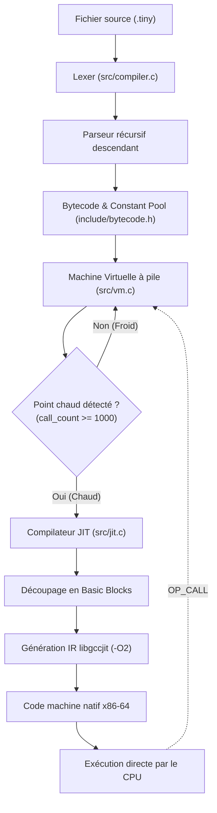

# TinyJIT

[](https://en.wikipedia.org/wiki/C11_(C_standard_revision))
[](https://gcc.gnu.org/onlinedocs/jit/)
[]()
[]()

**TinyJIT** est un environnement d'exécution complet pour un langage dynamique impératif. Il combine une chaîne de compilation front-end, un interpréteur de bytecode à pile et un compilateur **Just-In-Time (JIT)** natif propulsé par **`libgccjit`**.

Lorsqu'une fonction est fréquemment appelée (« point chaud »), le moteur JIT traduit automatiquement son bytecode en code machine natif **x86-64** optimisé (`-O2`), offrant des accélérations supérieures à **200x** par rapport à l'interpréteur classique.

---

## 🏛 Architecture globale



### Le pipeline d'exécution en 3 niveaux :
1. **Front-End (`src/compiler.c`)** : Analyse lexicale et syntaxique d'une seule passe qui génère directement le bytecode, résout les variables locales et applique le *backpatching* pour les sauts conditionnels.
2. **Interpréteur réentrant (`src/vm.c`)** : Machine virtuelle à pile exécutant le cycle *Fetch-Decode-Execute*. Chaque appel instancie son propre frame sur la pile C, permettant les appels imbriqués et la récursion.
3. **Moteur JIT (`src/jit.c`)** : Découpe le bytecode en blocs de base (*Basic Blocks*), simule la pile d'évaluation à la compilation, et génère du code machine natif en mémoire exécuté via un pointeur de fonction.

---

## 📜 Le Langage `.tiny`

Le langage supporte les entiers signés 64 bits (`int64_t`), les variables locales, les conditions, les boucles et les fonctions récursives.

### Exemple : Suite de Fibonacci récursive (`script.tiny`)
```c
// Définition d'une fonction récursive
fn fib(n) {
    if (n < 2) {
        return n;
    }
    return fib(n - 1) + fib(n - 2);
}

// Point d'entrée obligatoire du programme
fn main() {
    return fib(20);
}
```

### Exemple : Boucle arithmétique avec accumulateur
```c
fn sum_to(n) {
    var acc = 0;
    while (0 < n) {
        acc = acc + n;
        n = n - 1;
    }
    return acc;
}

fn main() {
    return sum_to(1000);
}
```

---

## ⚙️ Jeu d'instructions (ISA Bytecode)

La machine virtuelle opère sur des entiers 64 bits (`int64_t`) au sommet d'une pile d'évaluation :

| Opcode | Argument | Effet sur la pile | Description |
| :--- | :---: | :---: | :--- |
| `OP_CONST` | `index` | `[ ] -> [ val ]` | Charge la constante `constants[index]` sur la pile |
| `OP_LOAD` | `slot` | `[ ] -> [ val ]` | Charge la variable locale `locals[slot]` sur la pile |
| `OP_STORE` | `slot` | `[ val ] -> [ ]` | Dépile et stocke la valeur dans `locals[slot]` |
| `OP_ADD` | — | `[ a, b ] -> [ a + b ]` | Addition arithmétique entière |
| `OP_SUB` | — | `[ a, b ] -> [ a - b ]` | Soustraction entière |
| `OP_MUL` | — | `[ a, b ] -> [ a * b ]` | Multiplication entière |
| `OP_DIV` | — | `[ a, b ] -> [ a / b ]` | Division entière (avec garde anti-division par zéro) |
| `OP_LT` | — | `[ a, b ] -> [ a < b ? 1 : 0 ]` | Test d'infériorité stricte |
| `OP_EQ` | — | `[ a, b ] -> [ a == b ? 1 : 0 ]` | Test d'égalité |
| `OP_JUMP` | `offset` | `[ ] -> [ ]` | Saut inconditionnel vers l'instruction cible |
| `OP_JUMP_IF_FALSE` | `offset` | `[ cond ] -> [ ]` | Dépile la condition ; si `0`, saute vers l'instruction cible |
| `OP_CALL` | `func_idx` | `[ args... ] -> [ res ]` | Appelle `func_table[func_idx]` et empile le retour |
| `OP_RET` | — | `[ res ] -> [ ]` | Termine la fonction et renvoie la valeur de retour |

---

## ⚡ Pont JIT $\leftrightarrow$ Interpréteur (`OP_CALL`)

Un défi majeur de la compilation JIT sous Windows (**PE/COFF**) réside dans l'appel entre du code machine natif compilé à la volée en mémoire et le moteur d'exécution C hôte. 

TinyJIT résout ce problème avec **`gcc_jit_context_new_call_through_ptr`** :
1. L'adresse mémoire absolue de la fonction d'évaluation `vm_run` est directement injectée dans le graphe d'instructions de `libgccjit`.
2. Le code assembleur génère un appel indirect direct (`call *%rax`) vers `vm_run`.
3. **Résultat :** Zéro dépendance d'édition de liens dynamique (`ld.exe`), zéro bibliothèque d'importation `.a` requise, et une compatibilité binaire immédiate.

---

## 📊 Performances & Benchmarks

Mesures effectuées sur Windows 11 (AMD64 / MSYS2 UCRT64 GCC 16.2.0, `-O2`) sur le calcul de $\sum_{i=1}^{10000} i$ répété 5 000 fois :

| Mode d'exécution | Temps d'exécution | Accélération | Caractéristiques |
| :--- | :---: | :---: | :--- |
| **Interpréteur pur** | `5 480 ms` | $1.0\times$ (référence) | Boucle *Fetch-Decode-Execute* en C |
| **Hybride (Interpréteur + JIT)** | `1 814 ms` | $\mathbf{3.0\times}$ | Phase d'interprétation + compilation en mémoire |
| **Code Natif JIT pur** | `23 ms` | $\mathbf{232.0\times}$ | Code machine x86-64 direct avec registres CPU |

---

## 🛠 Prérequis et Installation

### Windows (MSYS2 / UCRT64)
1. Installez [MSYS2](https://www.msys2.org/).
2. Dans le terminal MSYS2 UCRT64, installez le compilateur GCC et `libgccjit` :
   ```bash
   pacman -S mingw-w64-ucrt-x86_64-gcc mingw-w64-ucrt-x86_64-libgccjit
   ```

### Linux (Debian / Ubuntu)
```bash
sudo apt-get update
sudo apt-get install build-essential libgccjit-12-dev
```

---

## 🚀 Compilation et Utilisation

### 1. Compilation
Sous PowerShell :
```powershell
.\build.ps1
```
*Ou via Make :*
```bash
make
```

### 2. Exécution d'un script `.tiny`
```powershell
.\my_jit_vm.exe script.tiny
```
**Sortie :**
```text
[JIT] Compilation native de 'fib' (1000 appels)...
[JIT] Compilation reussie -> bascule sur le code natif !
>> Resultat de script.tiny : 6765
```

### 3. Inspection de l'assembleur x86-64 généré (`--dump-asm`)
Le flag `--dump-asm` permet de visualiser l'assembleur produit par `libgccjit` et génère un fichier d'analyse C pseudo-compilé :
```powershell
.\my_jit_vm.exe script.tiny --dump-asm
```
**Extrait de l'assembleur x86-64 produit à la volée :**
```x86asm
fib:
    pushq   %rsi
    pushq   %rbx
    subq    $56, %rsp
    movq    (%rcx), %rax
    cmpq    $1, %rax
    jle     .L1
.L4:
    movabsq $140701962018782, %rbx
    leaq    -1(%rax), %rdx
    subq    $2, %rax
    movabsq $2375107032080, %rcx
    movq    %rdx, 32(%rsp)
    leaq    32(%rsp), %rdx
    movq    %rax, 40(%rsp)
    call    *%rbx
    ...
```

### 4. Lancer les benchmarks et tests unitaires intégrés
Lancez simplement l'exécutable sans argument :
```powershell
.\my_jit_vm.exe
```

---

## 📂 Structure du Projet

```text
tinyjit/
├── build.ps1               # Script de compilation PowerShell rapide
├── Makefile                # Configuration de build GNU Make
├── script.tiny             # Programme de test Fibonacci récursif
├── README.md               # Documentation technique du projet
├── include/
│   ├── bytecode.h          # Définitions des opcodes et structures BytecodeFunction
│   ├── compiler.h          # Interface du compilateur source -> bytecode
│   ├── jit.h               # Interface du compilateur JIT libgccjit
│   └── vm.h                # Interface de l'interpréteur de machine virtuelle
└── src/
    ├── bytecode.c          # Gestion de la mémoire et émission des instructions
    ├── compiler.c          # Lexer et Parseur récursif descendant
    ├── jit.c               # Traduction IR libgccjit, Basic Blocks et JIT compilation
    ├── main.c              # Point d'entrée CLI, gestion des arguments et benchmarks
    └── vm.c                # Boucle d'exécution de la machine virtuelle
```

---

## 👥 Auteur & Licence

Projet développé dans le cadre de l'étude des machines virtuelles et des techniques de compilation Just-In-Time.
- **Dépôt GitHub :** [sami-dev-dz/tinyjit](https://github.com/sami-dev-dz/tinyjit)
- **Licence :** MIT
